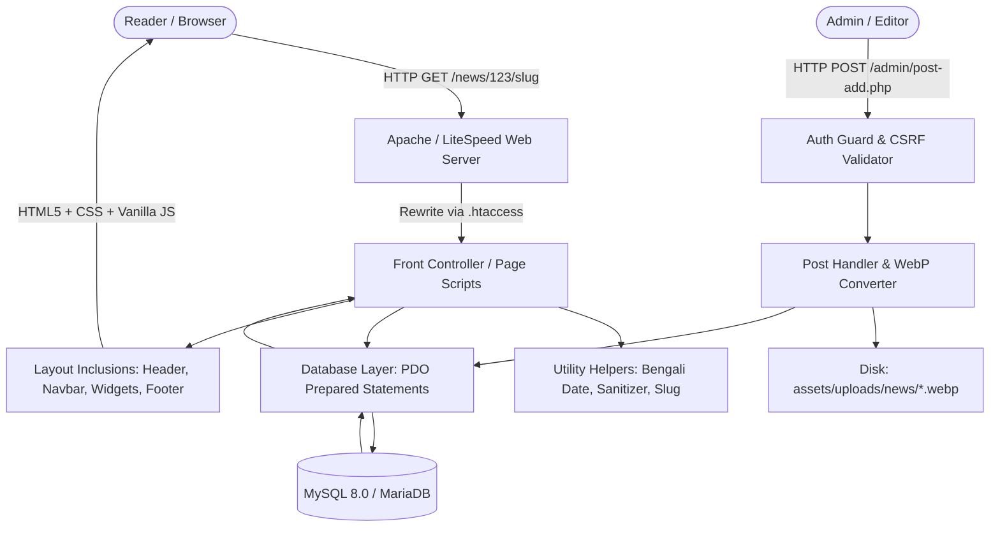
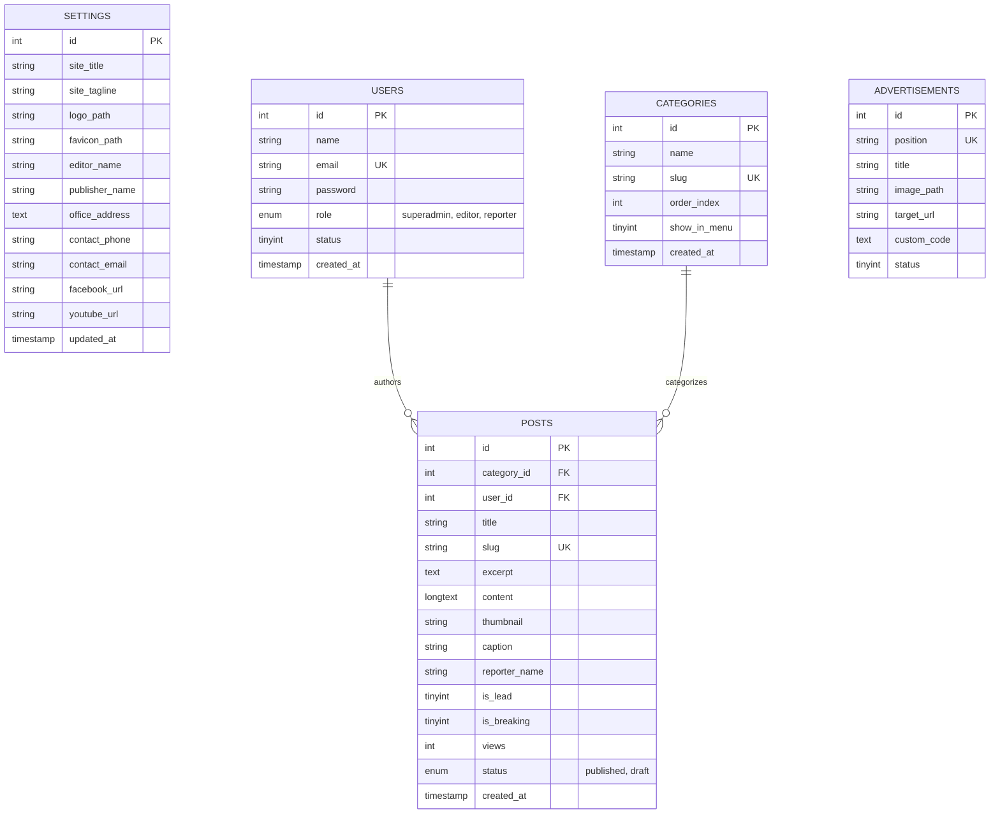

# Technical Architecture: Alokito Gour Clone

## 1. System Architecture Overview

The system is constructed with a modular, lightweight PHP 8.2+ architecture, engineered specifically for high-concurrency performance on standard cPanel Apache/LiteSpeed web servers without heavy process managers or external daemon dependencies.



---

## 2. Directory Hierarchy & Code Organization

```
/
├── PRD.md                         # Product Requirements Document
├── architecture.md                # System Architecture & ERD Specifications
├── Design.md                      # UI/UX, Design Tokens, and Breakpoint Specs
├── rules.md                       # Engineering Standards & cPanel Directives
├── Memory.md                      # Project State & Deployment Memory
├── Tasks.md                       # Granular Execution Checklist
├── setup.sql                      # Complete MySQL Schema & Seed Data
├── .htaccess                      # Apache Mod_Rewrite, Gzip & Browser Caching
│
├── config/
│   └── db.php                     # PDO Connection Singleton & Env Configurations
│
├── includes/
│   ├── helpers.php                # Utility library (Bengali date/number, sanitize, WebP uploader)
│   ├── header.php                 # Meta tags, top bar, dynamic logo & header banner
│   ├── navbar.php                 # Dynamic navigation bar, categories, mobile drawer & search modal
│   ├── ticker.php                 # Dynamic breaking news marquee ticker
│   ├── sidebar.php                # Tabbed widgets (Latest / Popular), category filter, ads
│   └── footer.php                 # Dynamic footer, contact details, editor info & copyright
│
├── assets/
│   ├── css/
│   │   └── style.css              # Frontend styling, SolaimanLipi typography, responsive grid
│   ├── js/
│   │   └── main.js                # Vanilla JavaScript for mobile drawer, tabs, ticker
│   └── uploads/
│       └── news/                  # Uploaded news media (chmod 755, WebP format)
│
├── admin/
│   ├── assets/
│   │   ├── css/admin.css          # Responsive Admin Panel stylesheet
│   │   └── js/admin.js            # Admin client scripts (image preview, alerts, confirmation)
│   ├── includes/
│   │   ├── auth_guard.php         # Session verification and CSRF protection helper
│   │   ├── header.php             # Admin layout top bar
│   │   ├── sidebar.php            # Admin navigation sidebar
│   │   └── footer.php             # Admin layout footer
│   ├── index.php                  # Dashboard overview (KPI stats, recent articles)
│   ├── login.php                  # Secure authentication gate
│   ├── logout.php                 # Session termination
│   ├── post-add.php               # News composer with Summernote & WebP processor
│   ├── post-list.php              # Paginated article table with filter and search
│   ├── post-edit.php              # Article editor and thumbnail updater
│   ├── categories.php             # Category taxonomy manager
│   ├── ads-manager.php            # Banner advertisement placement manager
│   └── settings.php               # Portal identity & contact management
│
├── index.php                      # Homepage (Lead news, category blocks, widgets)
├── single.php                     # Article detail page (Views increment, social share, related news)
├── category.php                   # Category archive with pagination
└── search.php                     # Full-text search result page
```

---

## 3. Database Entity-Relationship Diagram (ERD)



### Key Relationships & Foreign Keys
- `posts.category_id` references `categories.id` (`ON DELETE CASCADE`): When a category is removed, its posts are cleanly cascaded or managed.
- `posts.user_id` references `users.id`: Identifies editorial authorship.
- Selective indexing on `posts(category_id)`, `posts(is_lead)`, `posts(is_breaking)`, `posts(views)`, and `posts(created_at)` guarantees sub-millisecond query execution even with tens of thousands of articles.

---

## 4. Routing & URL Rewriting (`.htaccess`)

The portal employs Apache `mod_rewrite` to deliver clean, human-readable, and SEO-friendly Bengali permalinks:

```apache
RewriteEngine On
RewriteBase /

# 1. News Single Page: /news/{id}/{slug} -> single.php?id=$1&slug=$2
RewriteRule ^news/([0-9]+)/?([a-zA-Z0-9\-_%]+)?/?$ single.php?id=$1&slug=$2 [L,QSA]

# 2. Category Archive: /category/{slug} -> category.php?slug=$1
RewriteRule ^category/([a-zA-Z0-9\-_%]+)/?$ category.php?slug=$1 [L,QSA]

# 3. Search Route: /search -> search.php
RewriteRule ^search/?$ search.php [L,QSA]
```

---

## 5. Security Architecture

1. **SQL Injection Defense**:
   - Zero raw concatenation in SQL queries.
   - All dynamic parameters are bound using PDO prepared statements (`$stmt->execute([':param' => $value])`).
   - Global PDO attribute: `PDO::ATTR_EMULATE_PREPARES => false`.

2. **Cross-Site Scripting (XSS) Mitigation**:
   - All dynamic strings printed to HTML templates are sanitized via a central escaping helper:
     ```php
     function e(?string $value): string {
         return htmlspecialchars($value ?? '', ENT_QUOTES, 'UTF-8');
     }
     ```
   - Rich text content generated via Summernote is stripped of malicious `<script>` tags, event handlers (`onload`, `onerror`), and `javascript:` URIs prior to storage or rendering.

3. **Cross-Site Request Forgery (CSRF) Protection**:
   - Every administrative form injects a cryptographically secure CSRF token:
     `$_SESSION['csrf_token'] = bin2hex(random_bytes(32));`
   - Form submissions validate `hash_equals($_SESSION['csrf_token'], $_POST['csrf_token'])`.

4. **Authentication & Session Security**:
   - Password hashes generated using `password_hash($password, PASSWORD_BCRYPT, ['cost' => 12])`.
   - `session_regenerate_id(true)` executed upon successful login to thwart session fixation attacks.
   - Session cookies configured with `HttpOnly`, `SameSite=Lax`, and `Secure` (when SSL is present).

5. **File Upload Hardening**:
   - Strict MIME-type checking (`image/jpeg`, `image/png`, `image/webp`).
   - PHP execution blocked in the `assets/uploads/` directory via `.htaccess` (`php_flag engine off`).
   - Uploaded files are programmatically transcoded to `.webp` format with randomized file names (e.g. `news_653a9f1b.webp`).
